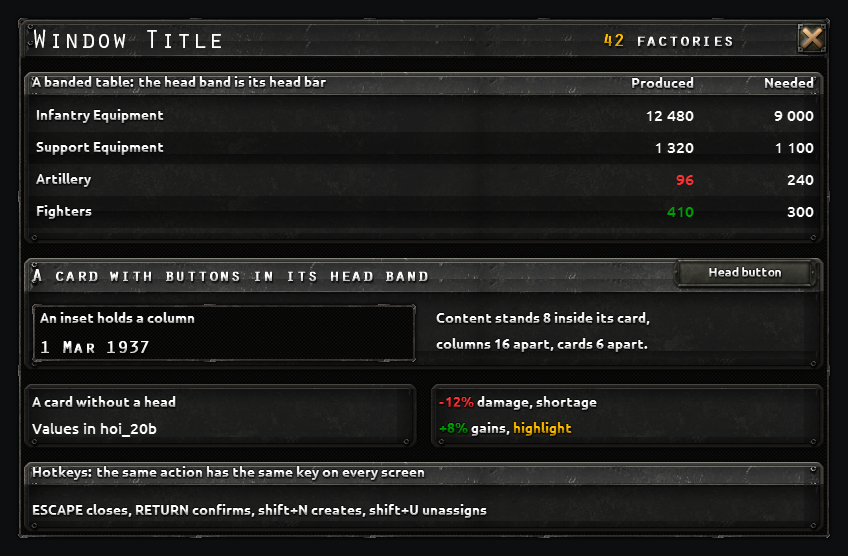

# Design Language

> (from the 1440p mod) Copied at the split of 2026-10-21 from the HOI4 1440p UI Mod, whose reworked vanilla screens it still describes beside the pages; a later pass trims it to the pages.

The ruleset every reworked screen, manager page and Records page follows, so that they read as one design. The numbers live in `tools/layout.py` (`FONTS`, `GAP`, `ROW_PITCHES`, `STEEL_HEADS`, `PLATES`), the hotkeys in `tools/hotkeys.json`; `tools/lint_layout.py` holds a layout file to them and `tests/ScreenInvariants.Tests.ps1` holds the files to the hotkey table. [Design Rules](Design-Rules.md) keeps the engine limits, the reasons and the evidence; the phases that shaped the look are A9, A10, C1 and the second A3 redesign.

The user's standing judgements: bold card-style layouts, not enlarged vanilla (2026-10-16); lists of figures as banded tables, not label-over-value tiles (A3, 2026-10-16); nothing overflows its card in the game. Since 2026-10-21 (user decisions): **the steel look of C1 is the default**, the close button sits at the title strip's right edge, and a hotkey means the same action on every screen.

## The look

A layout names its look (`"style": "steel"`, the default, or `"card"`). Screens built before 2026-10-21 keep the card style until a phase touches them again, and then move to steel.

### Steel (the default)

Cards cut from vanilla's gunmetal steel bar (`tiled_frontend_upper_bar`, the main menu's riveted bar), recoloured only, on a near-black ground. Each card is a bitmap made at its size: a layout names it by kind, `tools/apply_layout.py` writes the DDS (`gfx/interface/1440p_ui/<prefix>_<name>.dds`) and declares the sprite, and `tools/mockup.py` draws the same image.

| Piece | Kind in a layout | Made from | Size and place |
|---|---|---|---|
| Window ground | `background` of the window: `GFX_1440p_steel_ground` | `tiled_window_thin_border.dds`, border 8 | the window |
| Title strip | `steel_title` | the steel bar, lightened x1.25 | window width - 4, 46 high, at 2,2 |
| Card | `steel`, with `head` 27 (a line of text) or 38 (text and buttons), or none | the steel bar: head band lightened x1.9, its rule and groove, body darkened x0.8 | window width - 12, at x 6 |
| Inset (a column, a plot, a figure) | `inset` | `tiled_window_thin_border.dds`, border 8 (a tile) | as needed, 8 inside its card |
| Band (every second row) | `bands` | `black_bg_tile.dds`, border 3 (a tile) | the table's width, one row high |
| Anything else | `plate` with a `texture` or a `sprite` | a vanilla texture or sprite | as needed |

A card's head band is its head bar: the head text and the column heads of a table stand in it, so the steel look has no separate head piece. Names and key figures in `hoi_24header`, the figures of a table in `hoi_20b`.

### Card style (screens built before 2026-10-21)

| Piece | Kind | Texture | Border | Size |
|---|---|---|---|---|
| Window ground | `background` | `GFX_tiled_window_1b_thin_border` | | the window |
| Title strip | `title` | `gfx/interface/header_bg.dds` | 61x21 | window width - 6, 44 high, at 3,3 |
| Card | `card` | `gfx/interface/tiles/tiled_plain_bg_small.dds` | 16 | window width - 12, at x 6 |
| Head bar | `head` | `gfx/interface/tiles/tiled_header_1.dds` | 8 | card width - 16, 30 high (38 with buttons), at card x + 8 |
| Band | `bands` | `gfx/interface/tiles/black_bg_tile.dds` | 3 | head bar width, one row high |

The vanilla widgets stay children of their window and move onto the plates, so every widget the code looks up is still where it looks (A9, "How the cards are built"). The manager pages and the Records (`GFX_1440p_SG_*`) are the card style on scripted windows; they move to steel when a phase touches them.

## Spacing

| Between | Space |
|---|---|
| A card and the window edge; two cards | 6 (a tile shows its edge about 3 px inside, so the gap reads as 12) |
| Content and its card's edge; the items of one group; an inset and its card | 8 |
| An icon and its text, a value and its unit | 4 |
| Two columns or groups of a row | 16 |
| A row of a table | 24 (one line of `hoi_18mbs`), 32 (values in `hoi_20b` beside icons), 48 (two lines) |

## Fonts by role

An item of a layout may name its `role`; the linter then checks the font against the role, and without one against every font of the look. Text inside a fixed-size box that vanilla sizes (a count badge) keeps its vanilla font and is not named.

| Role | Steel | Card style |
|---|---|---|
| `title`: the window title | `hoi_36header` | `hoi_30header` in a fixed box (`fixedsize = yes`, W28), 32 high |
| `name`: the name of a card's subject (a line, a general, a state) | `hoi_24header` | `hoi_20b` |
| `figure`: a key figure in a title strip or head band (a count, a date) | `hoi_24header`, `hoi_20b` | `hoi_20b` |
| `value`: a value in a table | `hoi_20b`, right-aligned in a column of its widest value | the same |
| `caption`: head text, column heads, row text | `hoi_18mbs` (24 high) | the same |
| `button`: the text of a button in a head band | `hoi_16mbs` on the vanilla button sprite | the same |

Measure the widest text before choosing a column: `Mockup.text_width(font, text)` adds the `xadvance` values of the font (W11). A text another mod can make longer (a name, a label) gets a fixed box (W28).

## Tables

The head band of a card (steel) or a head bar (card style) holds the column heads; then rows at one pitch with a band on every second row (`bands` with `every = 2`); the caption column at the left in `hoi_18mbs`, values right-aligned in `hoi_20b`; the chosen row on a lighter plate where a list has a chosen row. Column order: what the row is (name, picture), then its state, then its figures. Rows that a code-filled grid lays out are banded with fixed plates at the grid's slot pitch (S37); a list box that scrolls bands its row window instead.

## Fixed places

- **The title strip**: the window title at the left; key figures (a count, a date) right-aligned before the close button.
- **The close button**: at the title strip's right edge, its right edge 2 to 8 px inside the strip's and its middle within 4 px of the strip's middle (user decision 2026-10-21; C1 has it at panel x -36, y 7). It keeps `shortcut = "ESCAPE"`. Where the top bar's alerts can cover it on a panel docked at the top, ESCAPE still closes the window.
- **Buttons in a head band**: at its right end, text in `hoi_16mbs`, in a head of 38.

## Hotkeys

One key per action on every screen, and one action per key (user decision 2026-10-21). `tools/hotkeys.json` lists every hotkey the mod adds under its action; the test fails on a hotkey that is missing there or has a key other than its action's.

- ESCAPE closes a window, RETURN confirms. The keys vanilla gives its own buttons stay as they are (`h` hold, `s` select half, `g` merge, the `ctrl+g` chords).
- A hotkey the mod adds is `shift+<letter>`. It takes the key of its action where the table has one (create a group `shift+n`, unassign `shift+u`, fold a manager page `shift+m`, a tab by its first letter: statistics `shift+a`, template `shift+t`, history `shift+h`), or a free letter for a new action, added to the table in the same change.
- The game adds the key to the button's tooltip by itself (X9, seen on a scripted button), so a tooltip does not repeat it.
- Clashes with the same screen and the vanilla file are checked as before (W5, W7); `contracts.md` lists the keys a phase adds.

## Colours and pictures

Only vanilla pixels: tiles of vanilla textures, pieces cut and widened by `tools/stretch_background.py`, the game's own icons and text colours (`§R`, `§G`, `§Y` runs). No AI-generated image anywhere. The game's highlight yellow for names on the scripted pages; red for damage and shortage, green for gains, and for nothing else.

## How the rules are checked

`python -I tools/lint_layout.py scratch/phases/<id>/layout.json` reports errors and warnings: `font` (a font outside the look or its role), `gap` (two neighbouring cards not 6 apart, or overlapping), `inset` (a text closer than 8 to its card's edge), `row` (a table row outside 24, 32, 48), `head` (a steel head band other than 27 or 38), `close` (the close button away from the strip's right edge), `look` (a piece or ground of the other look). A rule may be broken with a reason: `"why": "..."` on the item, or `"exceptions": [{"rule": "gap", "why": "..."}]` on the layout; the finding is then reported as excepted and the reason shows on the design page. The designer runs it before handing in, the orchestrator at gate A ([Workflow](Workflow.md), stage 3).

## Review questions

The rules above keep screens alike; these keep them useful. Every design answers them in `design.json` ([Workflow](Workflow.md), "Handoff files"), and the design page shows the answers beside the figures. They are Nielsen's ten usability heuristics and the game usability heuristics of Pinelle, Wong and Stach (2008), cut to what a redesign here can change; `tools/layout.py` (`HEURISTICS`) holds the same list for the tools.

| Id | Question | Asks |
|---|---|---|
| H1 | At a glance | The values the player checks most are readable without hovering, scrolling or opening anything. |
| H2 | The game's words | Vanilla terms, icons and units; no new name for a vanilla thing. |
| H3 | A way out | ESCAPE and the close button at the title strip's right edge close it; nothing covers the map without need. |
| H4 | Consistency | The pieces, fonts, spacing and hotkeys of the ruleset; the linter is clean or each exception has its reason. |
| H5 | Muscle memory | Frequent buttons keep vanilla's order and relative place, or the move is argued; destructive buttons stand apart from frequent ones. |
| H6 | State is shown | The selection, the open tab, the filters on and the folded parts are visible, not remembered. |
| H7 | Shortcuts | Frequent actions have a hotkey from the shared table. |
| H8 | One subject per card | Related values side by side, nothing shown twice, no empty space without a reason. |
| H9 | Hierarchy and legibility | The squinted figure keeps the title, the heads and the key figures; no text under the contrast floor. |
| H10 | Long text and many mods | Long names, many rows and other mods' values fit: fixed boxes, scrolling, `tools/check_playset.py` read. |

Each answer is `pass`, `issue` or `n/a` with a note; an `issue` is fixed in the design or becomes one of its `decisions`.

**Player tasks.** Three to five things a player comes to the screen for, in their words ("Which line is short of steel?", "Where is my best general?"), each counted on vanilla and on the proposal: the clicks it takes, and the places the eye has to go (a card, a tooltip, another window each count one). A proposal is no worse than vanilla on any task, or the difference is a decision for the user.

**Measured.** `python -I tools/ux_audit.py <id>` measures what a tool can: the linter's findings; the contrast of every text of the layout against what stands behind it in the mock-up (WCAG 2: 4.5:1, or 3:1 for text of 24 px and up or 19 px and up in a bold font; the game's text shadows read better than the ratio says, so a low ratio is a question, not a verdict); the fonts in use and how often; buttons under 24 px; and every figure group blurred and grey, the squint test: what still stands out is what the eye finds first, and a figure that only colour sets apart (`§R`, `§G`) fades, which says it needs a second cue. The design page shows all of it.

**The user's play verdict.** After the user plays a build in their own game, the phase notes record three answers under "Game checks": what they looked for and did not find; what they misread; what they still opened another screen or vanilla's window for.

## What a layout file looks like

The steel look: `tools/examples/steel-layout.json` (the catalogue above, every piece once). A built screen in the card style: `tools/examples/a10-layout.json`. The same file draws the mock-up (`python -I tools/mockup.py <layout> --out <png>`) and lays out the override file (`python -I tools/apply_layout.py <layout>`); its shape is in [Workflow](Workflow.md), "Handoff files".
